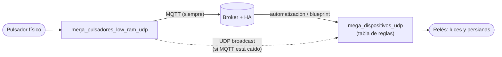

# `mega_pulsadores_low_ram_udp` (AceButton + UDP directo)

!!! warning "Prototipo — sin compilar ni probar en placa"
    Versión `0.1.0-udp`. El código está escrito pero **no se ha
    compilado ni flasheado todavía**, y el coste de RAM no está medido.
    Hasta que se pruebe en placa real, trátalo como un borrador. El
    firmware estable sigue siendo
    [`mega_pulsadores_low_ram`](mega-pulsadores-low-ram.md).

Copia de [`mega_pulsadores_low_ram`](mega-pulsadores-low-ram.md) (partida
de su versión 1.9.1) que, **además** de publicar los `HADeviceTrigger`
por MQTT como siempre, envía cada pulsación por **UDP broadcast** a las
placas [`mega_dispositivos_udp`](mega-dispositivos-udp.md). Sirve para
que luces y persianas **sigan funcionando con Home Assistant (o el
broker MQTT) caído**.

Todo lo demás es idéntico al original: AceButton, los 4 eventos, el
botón virtual opcional, `HABILITAR_DEBUG`, las unidades A/B/C. Los
cambios están marcados en el `.ino` con `HABILITAR_UDP`.

## Cómo encaja

Solo hace falta que funcione la red local (el switch). No hay ningún
otro equipo en el camino directo.

## Paquete UDP

5 bytes, enviados por broadcast (`255.255.255.255`) al puerto `47800`:

| Byte | Contenido |
|---|---|
| 0 | `0xA5` (marca; filtra tráfico ajeno, **no** es autenticación) |
| 1 | Letra de la placa de pulsadores: `'A'`, `'B'` o `'C'` |
| 2 | Pin del pulsador (el mismo número que el `pNN` de HA) |
| 3 | Evento: `1` corta, `2` doble, `3` larga (inicio), `4` larga (fin) |
| 4 | Nº de secuencia (para descartar la repetición) |

Broadcast en vez de IP concreta: el pulsador no necesita saber qué
placa de dispositivos controla cada luz. **Qué hace cada evento lo
decide el receptor**, con su [tabla de reglas](mega-dispositivos-udp.md#tabla-de-reglas).

Cada paquete se envía `UDP_REPETICIONES` veces (2 por defecto) seguidas,
porque UDP no tiene confirmación; el receptor descarta la copia por el
nº de secuencia.

## Cuándo envía: `UDP_MODO`

| Modo | Envía UDP… | Para qué |
|---|---|---|
| `UDP_MODO_SOLO_SIN_MQTT` (por defecto) | solo mientras `mqtt.isConnected()` es falso | Con HA funcionando solo actúan los blueprints; la placa solo entra de respaldo |
| `UDP_MODO_SIEMPRE` | siempre | Si el broker vive en otra máquina y solo cae HA |

!!! danger "`UDP_MODO_SIEMPRE` + blueprints = doble acción"
    Con HA vivo, la placa de dispositivos y el blueprint actuarían los
    dos sobre la misma pulsación: un *toggle* se anularía a sí mismo.
    Usa este modo **solo** para pulsadores que no tengan blueprint.

!!! warning "«MQTT caído» significa broker inalcanzable"
    Si el broker (Mosquitto) corre en otra máquina y solo cae Home
    Assistant, MQTT sigue conectado y el modo por defecto **no enviará
    UDP**. En ese montaje hay que usar `UDP_MODO_SIEMPRE`.

## Ajustes en el `.ino`

| `#define` | Por defecto | Qué hace |
|---|---|---|
| `HABILITAR_UDP` | activo | Comentarlo deja el firmware igual que `mega_pulsadores_low_ram` |
| `UDP_MODO` | `UDP_MODO_SOLO_SIN_MQTT` | Ver tabla de arriba |
| `UDP_PUERTO` | `47800` | Puerto de destino (el mismo en los receptores) |
| `UDP_PUERTO_LOCAL` | `47801` | Puerto de origen; distinto a propósito para que esta placa no acumule broadcasts ajenos |
| `UDP_REPETICIONES` | `2` | Veces que se envía cada paquete |
| `UDP_TIMEOUT_CONEXION_MQTT_MS` | `150` | Ver el aviso siguiente |

!!! warning "Con el broker caído, los reintentos MQTT bloquean el loop"
    Cada reintento de conexión TCP bloquea `loop()` hasta agotar el
    timeout de conexión, y `AceButton` necesita `check()` cada pocos
    ms. El valor por defecto de la librería Ethernet es 1000 ms, con lo
    que se perderían pulsaciones justo cuando el modo UDP más hace
    falta. Por eso el firmware lo baja a 150 ms con
    `client.setConnectionTimeout()`, que **requiere Ethernet ≥ 2.0.1**
    (si no compila, la librería es más antigua). Aun así, cada reintento
    sigue bloqueando hasta ese tiempo: comprueba en placa que las
    pulsaciones no se pierden con el broker apagado.

## RAM

**No medido.** Estimación: el buffer del paquete es de 5 bytes en la
pila y los buffers UDP viven en el chip Ethernet, no en la SRAM del
Mega; el coste debería ser de unas decenas de bytes más el código en
flash. Aun así, este firmware está diseñado para trabajar cerca del
umbral de inestabilidad (~370 bytes libres, ver
[RAM y rendimiento](../reference/ram.md)): activa `HABILITAR_DEBUG`, mide
"RAM libre" y compáralo con `mega_pulsadores_low_ram` en la misma unidad.

## Sockets del chip Ethernet

El W5100 tiene 4 sockets y el W5500 tiene 8. Esta placa usa 1 para MQTT
y 1 para UDP (el TCP de prueba del arranque se libera enseguida). Si al
arrancar sale `ERROR: sin socket UDP libre`, algo más los está
consumiendo.

## Limitaciones

- Solo los 4 eventos de AceButton: corta, doble, larga y fin de larga.
- Sin confirmación: si se pierden las 2 copias del paquete, no hay
  reintento.
- Cualquier equipo de la LAN puede enviar esos paquetes (ver
  [seguridad](mega-dispositivos-udp.md#seguridad)).
- Ningún blueprint de HA conoce este camino: las acciones por UDP no
  pasan por HA, así que no quedan en su historial.

## Configuración y `config.h`

Esta carpeta tampoco trae `config.h`, solo `config.h.example`. Sigue los
pasos de
[Configuración (config.h)](../getting-started/config.md#carpetas-udp-mismo-paso-extra-que-low_ram)
**antes** de rellenar credenciales reales.

Los ficheros `board_config_a.h`, `_b.h`, `_c.h` son copias independientes
de los de `mega_pulsadores_low_ram/`, no compartidos: si cambias pines,
MAC o IP en una carpeta, revisa la otra.
